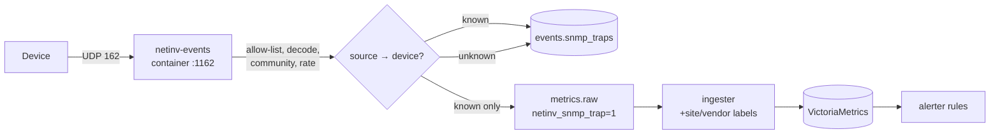

# 36 — SNMP trap intake

**Status:** draft · **Depends on:** 05, 08, 09, 20, 34 · The `netinv-events`
service: what it accepts, how a trap becomes a device's event and an alert, the
exposure of a second unauthenticated UDP listener, and the UI that reads it.

> **Validated against a simulator only (2026-10-21).** Every path below — v2c
> traps, v1 traps, informs, link traps with an ifIndex, unknown sources, the
> two built-in rules — has been exercised end to end against `snmptrap` from
> net-snmp, sending as a simulated FortiGate. No trap from real hardware has
> been received yet. The vendor names in §3 are taken from the vendors' MIB
> text and have not been compared with what a real FortiGate or PA-series
> appliance sends.

## 1. Why this service exists, and what it is not

Polling sees a device every cadence interval and only what the MIB currently
says. A trap is what the device says the moment something happens — a VPN
tunnel dropped, an HA pair failed over, someone tried a wrong community — and
much of that never appears in a polled counter at all. ADR-025 brings SNMP traps
in from the deferred list for that reason.

It is deliberately narrow:

- **SNMP v1 and v2c traps, and v2c informs.** SNMPv3 traps are counted as
  `unsupported` and dropped; receiving them needs per-sender USM engine IDs and
  keys, which is its own piece of work.
- **No syslog.** It remains deferred (doc 29); the event store is shaped so it
  can join later, but nothing reads it yet.
- **No correlation, deduplication or trap-to-alert mapping table.** A trap is
  stored as received and turned into a metric sample; alerting is ordinary
  rules over that metric (§4).

## 2. The path of one trap

1. **Allow-list.** `NETINV_TRAP_ALLOW` (comma-separated prefixes or addresses).
   Empty accepts any source — the right default for a first install, the wrong
   one to leave in place.
2. **Decode** with gosnmp. Bounded: at most 64 varbinds and 512 bytes per value
   are kept. A v1 trap is mapped onto its v2 OID per RFC 3584 §3.1 — generic
   traps 0–5 to `snmpTraps.{n+1}`, enterprise-specific ones to
   `enterprise.0.specific` — so both versions share one name and one rule.
3. **Community.** `NETINV_TRAP_COMMUNITIES` (comma-separated). Empty accepts
   any. The community is compared and never stored.
4. **Per-source rate limit**, a token bucket of 20/s with a burst of 200
   (`NETINV_TRAP_RATE` sets the rate). A link flap on a large switch is a
   legitimate burst; a looping sender is an endless one.
5. **Resolve** the source address to a device: its management address first,
   then any address claimed in its `flow_exporters` list (doc 34 §3.1), then the
   v1 agent-address field. Gateways often send from their WAN side, exactly as
   they do for flow, and the same claim covers both.
6. **Acknowledge** an inform immediately, before storage, so the agent does not
   retry because our queue was slow.
7. **Queue** (10 000 deep, never blocking the socket), then batch-insert every
   second into `events.snmp_traps` and publish one sample per trap from a known
   device.

The listener binds 1162 inside the container, because the container runs
neither as root nor with `CAP_NET_BIND_SERVICE`; Compose maps host UDP 162
(`NETINV_TRAP_PORT`) onto it, so devices send to the standard port. **Docker's
port mapping preserves the source address** — verified with the simulator — so
attribution works through it.

It runs as a **single replica**, for the same reason flow does (doc 34): a trap
is sent once to one address, and a second replica behind it would only split
the stream.

## 3. Names

A trap is identified by its OID. The `trap_name` stored with it and the `trap`
label on its metric come from two tables:

| Table | Source | Confidence |
|---|---|---|
| `names.go` | SNMPv2-MIB, IF-MIB, BGP4-MIB, ENTITY-MIB | Fixed by RFC; cannot be wrong for a vendor |
| `names_vendor.go` (714 entries) | FORTINET-CORE-MIB, FORTINET-FORTIGATE-MIB, PAN-TRAPS | Generated from the vendors' MIB text, **unverified against hardware** |

`names_vendor.go` is generated by `scripts/gen-trap-names.py`, whose header
carries the commands to fetch the MIBs and regenerate it. It takes only
notifications under the known trap roots
(`1.3.6.1.4.1.12356.101.2.0`, `.101.6.0`, `.100.1.3.0` and
`1.3.6.1.4.1.25461.2.1.3.2.0`) and reports anything else rather than guessing
where it belongs. Do not hand-edit it.

Anything in neither table is labelled by its numeric OID, which an operator can
still write a rule against.

## 4. Alerting

Each trap from a known device writes `netinv_snmp_trap = 1` at the moment of
receipt, labelled `trap` (name or OID) and, for traps carrying an IF-MIB varbind,
`if_index`. The ingester adds `device_id`, `site_id` and `vendor` as for any
other sample, so a fired alert links to its device and, where there is one, its
interface.

A trap has no "cleared" state of its own, so rules use a window:
`max_over_time(netinv_snmp_trap{…}[10m]) > 0` fires within one evaluation of the
trap arriving and resolves ten minutes after the last repeat. Migration 0019
ships two built-in rules:

| Rule | Severity | Fires on |
|---|---|---|
| `ar_trap_auth_failure` | warning | `authenticationFailure` — something is trying communities against the device |
| `ar_trap_received` | info | every trap **except** linkUp/linkDown, coldStart/warmStart and authenticationFailure |

Link and restart traps are excluded from `ar_trap_received` because polling
already alerts on them (interface down, device reboot), and a second alert for
the same event is noise. They are still stored and shown.

**Cardinality is bounded per device.** Each distinct `trap` label is a series,
and the label is chosen by whoever sends the datagram. After 100 distinct labels
on one device, further new ones are written as `trap="other"`. Unknown sources
write no series at all — otherwise any address passing the allow-list could
mint them.

Palo Alto's PAN-TRAPS defines log-forwarding notifications (`panTrafficTrap`,
`panThreatTrap`, …) alongside system events. A firewall configured to forward
traffic logs as traps will send one per session, which the rate limit will cut
and which `ar_trap_received` will alert on at info. Forward system and HA events
as traps; send traffic logs elsewhere.

## 5. Storage

`events.snmp_traps` (doc 08): one row per accepted trap — received time,
source, v1 agent address, resolved `device_id` (no foreign key, so deleting a
device keeps its history), version, inform flag, OID, name, `if_index`, and the
varbinds as JSON. Retention is `NETINV_TRAP_RETENTION` (default `30d`), pruned
hourly.

## 6. API and UI

- `GET /events/traps` (doc 09) — `device_id`, `unknown=1`, `q` (name substring
  or OID prefix), `before` (keyset cursor), `limit`; under `devices:read`.
- **Traps** in the navigation: the fleet list, with a filter for unknown
  sources. An unknown source is worth looking at — a device not in inventory,
  or a gateway sending from an address nobody has claimed.
- **Traps** tab on device detail: the same table filtered to the device.

## 7. Exposure

This is the second component, after `netinv-flow`, that accepts unsolicited
input from the network (doc 20 §1). v1/v2c have no real authentication: the
community crosses the wire in clear and any host can spoof a source address. The
controls, in order of weight:

1. A firewall rule or `NETINV_TRAP_ALLOW` restricting who can reach UDP 162.
2. `NETINV_TRAP_COMMUNITIES`.
3. The resource bounds — rate limit, queue depth, varbind and value limits,
   label cap — which are what stop a hostile sender from turning storage or
   the metric store into the attack surface.

A spoofed trap can raise a false info or warning alert. It cannot change
inventory, credentials or configuration; nothing in a trap is acted on.

## 8. Operating it

- **Silence in the log means silence on the wire.** The service logs
  `trap intake` once a minute only when something arrived, with counters for
  refused, malformed, unsupported, bad community, rate-limited, queue-full and
  unknown-source.
- **Probe the receive path** with
  `snmptrap -v2c -c <community> <host> '' 1.3.6.1.6.3.1.1.5.1` and look for the
  row on the Traps page.
- **A trap shows as an unknown source** when the device sends from an address
  other than its management IP: add that address to the device's flow exporter
  list, which covers traps too.

## 9. Not yet written

- SNMPv3 traps and informs (USM).
- Syslog.
- Verified vendor names: the first real FortiGate or PAN-OS trap should be
  checked against §3's table, and the result recorded here as doc 10 does for
  polling.
- Helm: the chart is paused (ADR-024) and does not include this service.
